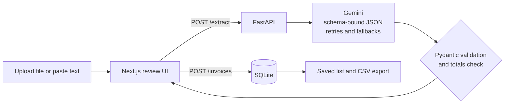

# Invoice Desk


**Live demo:** https://YOUR-PRODUCTION-ADDRESS
(Free hosting: the first load can take up to a minute while the server wakes up. Please upload only sample or non-sensitive invoices.)

Invoice Desk turns invoice documents into validated, structured data. Upload a PDF, photo, or text, Google Gemini extracts the fields against a strict schema, automated checks catch inconsistencies, and a reviewer corrects anything uncertain before the invoice is saved.

## Table of contents

- [Features](#features)
- [How it works](#how-it-works)
- [Tech stack](#tech-stack)
- [Run locally](#run-locally)
- [Configuration](#configuration)
- [API reference](#api-reference)
- [Demonstrations](#demonstrations)
- [Deployment](#deployment)
- [Limitations](#limitations)
- [Roadmap](#roadmap)
- [License](#license)

## Features

- **Multi-format extraction:** PDFs, images (photos, screenshots, scans), and plain text, read directly by Gemini.
- **Schema-bound output:** the model fills a fixed schema, and a stricter Pydantic model re-validates the result.
- **Automatic checks:** line items must sum to the document total, quantities must be positive, and every mismatch is flagged for review.
- **Review interface:** the original document sits next to editable fields, and fields the model was unsure about are highlighted.
- **Resilient model calls:** retries with backoff when the model is busy, then falls back to other models.
- **Saved invoices:** stored per visitor, with status (Accepted or Needs review), delete, and CSV export.
- **Abuse protection:** upload size limits, an hourly extraction limit per IP, and per-visitor data separation.

## How it works



1. The browser sends the file to `/extract` along with an anonymous visitor ID.
2. The backend sends the document and a strict prompt to Gemini and requests JSON matching a schema.
3. The response is validated again by the stricter `Invoice` model. Unparseable answers are retried.
4. The UI shows the extracted fields next to the original. The reviewer corrects them, and the totals check updates live.
5. Saving stores the invoice with its status. Invoices whose totals do not match are saved as "Needs review".

## Tech stack

| Layer | Technology |
|---|---|
| Backend | Python, FastAPI, Pydantic, SQLite |
| LLM | Google Gemini via the `google-genai` SDK |
| Frontend | Next.js, React, TypeScript, Tailwind CSS |
| Tests | pytest, FastAPI TestClient |
| Hosting | Vercel (frontend), Render (backend) |

## Run locally

**Requirements:** Python 3.11+, Node.js 20+, and a free Gemini API key from [Google AI Studio](https://aistudio.google.com).

**Backend**

```bash
git clone https://github.com/Valentina14142000/invoice-desk.git
cd invoice-desk/backend

python3 -m venv .venv
source .venv/bin/activate          # Windows: .venv\Scripts\activate
pip install -r requirements.txt

echo "GEMINI_API_KEY=your-key-here" > .env

python -m pytest -v                # run the tests
python -m uvicorn main:app --reload
```

The API runs at http://127.0.0.1:8000, with interactive docs at `/docs`.

**Frontend** (in a second terminal)

```bash
cd invoice-desk/frontend
npm install
echo "NEXT_PUBLIC_API_URL=http://127.0.0.1:8000" > .env.local
npm run dev
```

Open http://localhost:3000.

## Configuration

**Backend** (`backend/.env` locally, environment settings on Render)

| Variable | Purpose | Default |
|---|---|---|
| `GEMINI_API_KEY` | Gemini API key (required) | none |
| `GEMINI_MODEL` | Primary model | `gemini-3.8-flash` |
| `GEMINI_FALLBACKS` | Comma-separated backup models | `gemini-3.5-flash,gemini-3.1-flash-lite` |
| `ALLOWED_ORIGINS` | Comma-separated allowed frontend origins | `http://localhost:3000,http://127.0.0.1:3000` |
| `EXTRACT_PER_HOUR` | Extractions allowed per IP per hour | `10` |

**Frontend**

| Variable | Purpose |
|---|---|
| `NEXT_PUBLIC_API_URL` | Backend base URL, with no trailing slash |

Never commit `.env` files. Model names change over time, so update `GEMINI_MODEL` if Google retires one.

## API reference

All `/invoices` and `/extract` requests require an `X-Client-Id` header (8 to 64 letters, digits, or dashes). The web app generates one per browser and uses it to keep each visitor's data separate.

| Method | Path | Description |
|---|---|---|
| `GET` | `/health` | Liveness check |
| `POST` | `/validate` | Validate an invoice JSON body and run the totals check |
| `POST` | `/extract` | Extract fields from an uploaded file (`file`) or pasted text (`text`) |
| `GET` | `/invoices` | List the visitor's saved invoices |
| `POST` | `/invoices` | Save an invoice. Status is set automatically |
| `DELETE` | `/invoices/{id}` | Delete a saved invoice |
| `GET` | `/invoices/export.csv` | Download saved invoices as CSV, one row per line item |

Limits: 8 MB per file, 50,000 characters of pasted text, 10 extractions per hour per IP.

### Invoice schema

| Field | Type | Rules |
|---|---|---|
| `vendor`, `invoice_no`, `date` | string | required |
| `lines[].desc` | string | required |
| `lines[].qty` | number | greater than 0 |
| `lines[].unit` | number | 0 or greater |
| `total` | number | required |
| `currency` | string | defaults to `USD` |

**Business rule:** `sum(qty * unit)` must equal `total` within 0.01.

## Demonstrations

### 1. Extract an invoice

```bash
curl -X POST http://127.0.0.1:8000/extract \
  -H "X-Client-Id: demo-client-1234" \
  -F "file=@sample-invoice.txt"
```

Example response (the values depend on the model):

```json
{
  "vendor": "ACME Supplies Ltd",
  "invoice_no": "A-1042",
  "date": "2026-09-28",
  "currency": "USD",
  "lines": [
    {"desc": "Toner cartridge", "qty": 3, "unit": 45.0},
    {"desc": "Delivery", "qty": 1, "unit": 12.5}
  ],
  "total": 150.0,
  "uncertain": []
}
```

### 2. Catch a total that does not add up

The lines above sum to 147.50, but the document says 150.00:

```bash
curl -X POST http://127.0.0.1:8000/validate \
  -H "Content-Type: application/json" \
  -d '{"vendor":"ACME","invoice_no":"A-1","date":"2026-09-28",
       "lines":[{"desc":"Toner","qty":3,"unit":45},{"desc":"Delivery","qty":1,"unit":12.5}],
       "total":150,"currency":"USD"}'
```

```json
{"valid": true, "totals_match": false}
```

In the web app this shows as an amber "Needs review" banner stating how far off the total is.

### 3. Malformed input is rejected

A line with `"qty": 0` returns HTTP 422 with a message naming the field, before any business logic runs.

## Deployment

- **Backend (Render):** root directory `backend`, build command `pip install -r requirements.txt`, start command `uvicorn main:app --host 0.0.0.0 --port $PORT`, health check path `/health`. Set `GEMINI_API_KEY` and `ALLOWED_ORIGINS`.
- **Frontend (Vercel):** root directory `frontend`. Set `NEXT_PUBLIC_API_URL` to the Render address and redeploy, because the value is applied at build time.
- The backend also allows origins matching `invoice-desk*.vercel.app` so preview deployments work.

## Limitations

- **Storage is temporary on free hosting.** SQLite lives on the server's disk, so saved invoices can disappear when the server restarts. A hosted Postgres would fix this.
- **Cold starts.** The free backend sleeps when idle, so the first request can take up to a minute.
- **Shared quota.** All users share one free Gemini quota. Busy or exhausted-quota errors are shown in the UI.
- **No accounts.** Visitors are identified by an anonymous ID stored in their browser. Clearing browser data loses access to saved invoices.
- **Privacy.** Documents are sent to Google Gemini. The free tier may use submitted content to improve Google's products, so use sample data only.

## Roadmap

- [x] FastAPI service, Pydantic schema, totals validation
- [x] Gemini extraction from images, PDFs, and text, with retries and model fallback
- [x] Review UI with side-by-side document view and uncertain-field highlighting
- [x] SQLite storage, per-visitor separation, CSV export
- [x] Automated tests (6)
- [x] Deployed on Vercel and Render
- [ ] Persistent database (hosted Postgres)
- [ ] Evaluation set with ground-truth labels and field-level accuracy reporting
- [ ] Tracing: latency, model used, retries, and cost per extraction
- [ ] Retrieval over past vendors to normalize names
- [ ] User accounts

## License

This project is licensed under the [MIT License](LICENSE).

